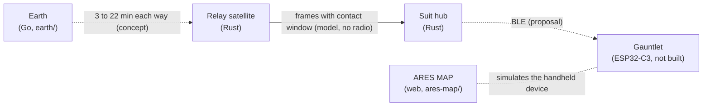
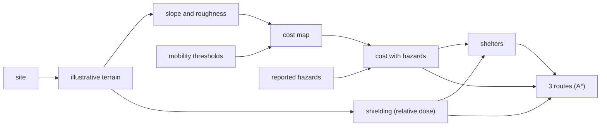

# Mars Map · NASA Space Apps Challenge 2026

Versión en español: [README.es.md](README.es.md)

**Mars Map** is a concept for a surface-exploration map of Mars, built for a walk outside the habitat, together with a
gauntlet (glove) that carries only the essentials: a map and alerts. The working part is **ARES MAP**, a web app that runs
entirely in the browser (no server, offline capable) and combines real NASA and USGS data with clearly labelled
illustrative data. Every datum on screen shows its source, date, tier and confidence. A Rust and Go prototype models how
alerts and map data would travel from Earth through a relay satellite and a suit hub to the glove. The idea is presented;
there is no hardware.

**Live demo:** <https://the-nordics-mars-map.vercel.app>
**Repository:** <https://github.com/Alandi1999/the-nordics-mars-map>

## Status at a glance

| Status | What |
|---|---|
| **Real** | Mars imagery (NASA Trek Viking mosaic; USGS MOLA, HRSC+MOLA hillshade, THEMIS day and night). Curiosity and Perseverance traverses and waypoints (NASA MMGIS). Earth-Mars distance and latency (computed offline, checked against JPL Horizons on 2 dates). Radiation baseline at Gale (MSL/RAD, 0.67 mSv/day, not real time) |
| **Illustrative** | Terrain relief of the 10 km area of interest and everything derived from it (slope, cost, shielding, shelters, routes). Surface weather series (invented). Space-weather alert values (invented; the format follows NASA DONKI). Mobility thresholds (team assumptions) |
| **Concept** | The glove, positioning without GPS, the protocol card and the health event simulator |
| **Prototype** | Rust/Go glove link: tested with unit tests, no radio, not connected to the web app |

The app shows these labels on screen. Data from one site (Gale or Jezero) is never shown on the other.

## What ARES MAP does

Nine tabs:

| Tab | What it does |
|---|---|
| **Map** | Pick a site, toggle base and thermal layers with opacity, prepare offline mode |
| **Points** | Real rover traverse and points of interest (waypoints, shelters); use any as start A or destination B |
| **Terrain** | Slope, roughness, contours, cost map and shading; editable mobility thresholds recompute live; click to probe a point |
| **Weather** | One-sol temperature and pressure (invented series, marked "ESTIMATED"); shortcut to the real THEMIS layers |
| **Route** | Three routes (shortest, safest, near a shelter) with distance, time, slope, risk and elevation profile; report a hazard and they recompute |
| **Safety** | Shielding layer, shelter zones, sample solar alerts and a protocol card with countdown, nearest shelter and time margin |
| **Crew** | Mission-sol slider, estimated accumulated radiation, five step-by-step event simulators, health risks with sources |
| **Link** | Earth-to-Mars latency for a date, a 2025-2030 chart and a "no response" warning |
| **Glove** | Concept view of the gauntlet screen: alert code, heading arrow, distance, link status (simulated position error) |

The app starts in English and has an EN / ES button to switch language.

## System overview



Solid line: modelled in Rust with tests, but no radio or transport. Dotted lines: proposal or simulation.

## Calculation chain in the app

The computation is a chain that is recomputed only when its input changes.



## Where every real datum comes from

The browser fetches these directly from the public servers; there is no backend of ours.

| Datum | Server | How it reaches the app | Scope | Limits |
|---|---|---|---|---|
| Viking MDIM 2.1 color mosaic | NASA Trek WMTS, `trek.nasa.gov/tiles/Mars/EQ/` | Image tiles, cached in `ares-tiles` for offline use | Global | Tiles only up to level 7 (about 325 m/px); blurry at walking scale |
| MOLA color, HRSC+MOLA hillshade, THEMIS day and night | USGS Astrogeology WMS, `planetarymaps.usgs.gov/cgi-bin/mapserv?map=/maps/mars/mars_simp_cyl.map` | WMS images, cached in `ares-tiles` | Global | Imagery only; no elevation values read from them |
| Curiosity and Perseverance waypoints | NASA MMGIS, `mars.nasa.gov/mmgis-maps/{MSL,M20}/Layers/json/` | Downloaded once (`scripts/build_rover_data.mjs`) into `src/data/*.rover.json`, shipped in the app | Curiosity 1389 waypoints (sol 3-5073); Perseverance 708 (sol 13-2022) | Snapshot retrieved 2026-11-15, not live |
| Earth-Mars distance and latency | Computed offline with `astronomy-engine`; no server | No request | Any date | Checked against JPL Horizons on 2 dates (within 0.1 %); the 3 and 22 min extremes were not validated |
| Radiation baseline at Gale | MSL/RAD, Hassler et al., *Science* 2014 | Constant in the code (0.67 mSv/day) | Gale only | Literature value (Aug 2012 - Jun 2013 mean), not real time |

Full details, including what is not real: [`docs/HOW_IT_WORKS.md`](docs/HOW_IT_WORKS.md).

## Glove link prototype (Rust and Go)

Code in `crates/` (Rust) and `earth/` (Go) defines how data would travel to the glove. Nothing here is connected to the web app.

- **Frame:** postcard serialisation, a CRC-32, and COBS framing (each frame ends with `0x00` so the receiver can resynchronise).
- **Sizes:** a real alert frame is **32 B** (17 B for a contact window), while default BLE gives **20 B** of useful payload per notification. The alert does not fit without a larger MTU or fragmentation.
- **Priority queue:** fixed capacity, no dynamic memory; alerts leave first, map tiles last. A full queue evicts the oldest message of the least urgent class present; a new alert never displaces other alerts.
- **Transmitter:** only sends inside a contact window, within a byte budget per window; a less urgent frame never overtakes a more urgent one that does not fit.
- **Hub:** keeps the highest version of tiles and POIs, drops duplicates and stale frames, and forwards only alerts, POIs and contact windows to the glove.
- **Tests:** 36 (`cargo test --workspace`).

### BLE and glove: honesty note

There is **no BLE code and no firmware**. The ESP32-C3 was chosen on paper because it has a BLE 5 radio; the shared core is `no_std` so it could compile for it, but it has not been compiled for the microcontroller. The Glove tab is a browser simulation. [TrouBLE](https://github.com/embassy-rs/trouble) (a Rust BLE host) lists the ESP32-C3 and its `ci.sh` builds the ESP32 example for `riscv32imc-unknown-none-elf`, per its repository; we did not run it on hardware or with our code. Details and open problems: [`docs/HOW_IT_WORKS.md`](docs/HOW_IT_WORKS.md), section 6.

## Quick start

```bash
cd ares-map
npm install
npm run dev                         # development
npm test                            # 61 tests
npm run build && npm run preview    # production build with service worker (offline mode)
```

```bash
cargo test --workspace              # 36 Rust tests
```

The three-minute demo script is in [`ares-map/docs/DEMO.md`](ares-map/docs/DEMO.md).

## Repository layout

| Path | What it is |
|---|---|
| [`ares-map/`](ares-map/) | The usable prototype (React, TypeScript, OpenLayers, installable PWA) |
| [`ARES_MAP_SPEC.md`](ARES_MAP_SPEC.md) | Technical specification the prototype starts from |
| [`crates/`](crates/), `Cargo.toml` | Rust prototype of the satellite, hub and glove link |
| [`earth/`](earth/) | Go module for the Earth side (data layers) |
| [`firmware/glove/`](firmware/glove/) | Glove firmware note (ESP32-C3), concept only |
| [`docs/HOW_IT_WORKS.md`](docs/HOW_IT_WORKS.md) | Architecture and data-flow guide (Spanish: `docs/COMO_FUNCIONA.md`) |

## Known limits

- The terrain relief is synthetic; only its elevation at one point per site matches a real waypoint. The rover traverse drawn on top is real.
- Surface weather is an invented series; REMS and MEDA data are not used.
- Solar alerts are a sample in the DONKI format, not a forecast.
- Mobility thresholds are team assumptions, not calibrated against Jezero.
- Base imagery is blurry at walking scale (Trek tiles stop at about 325 m/px).
- Several health items are marked "pending source".
- Grid models differ between parts: Rust/Go use 64x64 tiles of 100 m cells, the web app uses 20 m cells, the spec says 10 m.
- Tested in a desktop browser; not on a physical phone, other browsers or hardware.

## Credits

Data sources, licences and acknowledgements: [`ares-map/docs/CREDITS.md`](ares-map/docs/CREDITS.md). Endpoint probe notes: [`ares-map/docs/DATA_NOTES.md`](ares-map/docs/DATA_NOTES.md).
