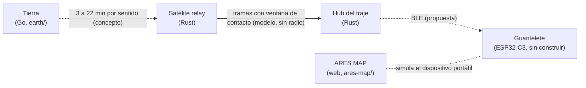
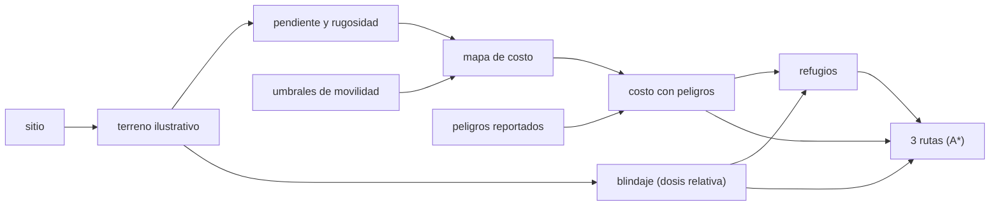
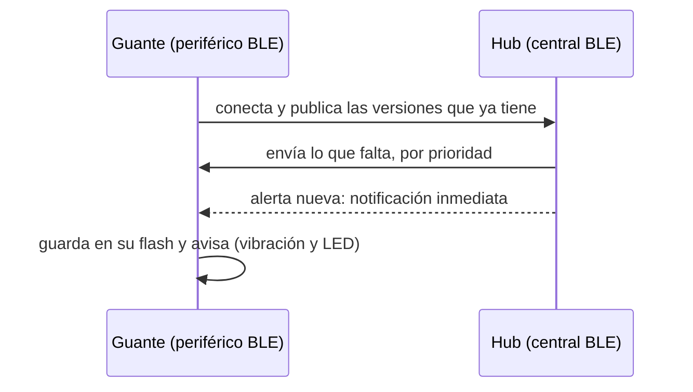

# Cómo funciona todo esto

Guía para entender el proyecto completo: qué hace, cómo está armado y cómo se conectaría con el guantelete.
Cada afirmación está marcada como **real** (existe y se probó), **simulado** (existe en pantalla pero no es lo real)
o **propuesta** (diseño pendiente, no construido).

## 1. En 30 segundos

El proyecto tiene dos partes que cuentan la misma idea:

1. **ARES MAP** (`ares-map/`): una app web que es el **mapa usable**. Es lo que se demuestra. Corre en el navegador,
   sin servidor, y sigue funcionando sin red.
2. **Prototipo del enlace del guantelete** (`crates/`, `earth/`): código en Rust y Go que define cómo viajarían los
   datos desde la Tierra hasta el guante (tramas, prioridades, colas). **No está conectado a la app web** y no
   hay hardware.

> **Sobre el BLE:** el guantelete *no tiene BLE todavía*. Se eligió la placa ESP32-C3 porque trae radio BLE 5, pero no hay
> ninguna línea de código Bluetooth ni firmware escrito. La pestaña «Guante» de la app es una **simulación** en el navegador.
> Ver la sección 6.

## 2. Qué es real y qué no

| Pieza | Estado | Detalle |
|---|---|---|
| Imágenes de Marte (Viking, MOLA, HRSC, THEMIS) | **Real** | Servidores públicos de NASA Trek y USGS |
| Trayectoria y waypoints de Curiosity y Perseverance | **Real** | NASA MMGIS, Curiosity hasta el sol 5073 y Perseverance hasta el 2022 |
| Distancia y latencia Tierra–Marte | **Real** | Efemérides offline, validadas contra JPL Horizons en **2 fechas** (15 y 16 de nov. de 2026), con diferencia menor a 0,1 %. Los extremos de 3 y 22 min no se validaron |
| Línea base de radiación en Gale (0,67 mSv/día) | **Real** | Medición del instrumento RAD, no es tiempo real |
| Relieve del AOI (10 km), pendientes, costo, blindaje, refugios | **Ilustrativo** | Terreno generado por el equipo, anclado a la elevación medida de un waypoint real; la app lo avisa en pantalla |
| Clima de superficie (temperatura y presión) | **Ilustrativo** | Serie **inventada** que imita un ciclo diario; el dato real vendría de REMS (Curiosity) o MEDA (Perseverance) |
| Alertas de clima espacial | **Ilustrativo** | Esquema de NASA DONKI con valores inventados |
| Tarjeta de protocolo, simulador de eventos de salud | **Concepto** | No es un procedimiento oficial |
| Pestaña Guante | **Simulado** | Posición simulada, no hay guante |
| Enlace Rust/Go | **Prototipo** | Se prueba con tests, no con radio |

## 3. Qué hace ARES MAP

Se organiza en nueve pestañas. Cada dato lleva una insignia con **fuente, fecha, nivel y confianza**; lo estimado
se marca como «ESTIMADO».

| Pestaña | Qué permite |
|---|---|
| **Mapa** | Elegir sitio (Gale o Jezero), activar capas base y térmicas con opacidad, y preparar el modo sin conexión |
| **Puntos** | Ver la trayectoria real del rover y los puntos de interés (12 waypoints reales por sitio, una zona inferida del boxwork solo en Gale y hasta 6 refugios calculados). Cada uno tiene ficha y se puede usar como inicio A o destino B |
| **Terreno** | Capas de pendiente, rugosidad, curvas de nivel, mapa de costo y sombreado. Umbrales de movilidad editables que recalculan todo en vivo. Clic para sondear un punto |
| **Clima** | Temperatura y presión de un sol (7 sols disponibles, con slider), con la franja de noche y los máximos y mínimos. **La serie es inventada**, está marcada «ESTIMADO» y usa la misma escala en todos los sols para poder compararlos. Desde aquí se activan las capas térmicas reales THEMIS de día y de noche |
| **Ruta** | Fijar A y B, o cargar un ejemplo. Compara tres rutas (más corta, más segura, con refugio cercano) con distancia, tiempo, pendiente, riesgo y perfil de elevación. **Reportar peligro** marca una zona bloqueada y las rutas se recalculan |
| **Seguridad** | Capa de blindaje, zonas de refugio, tres alertas solares de muestra y la tarjeta de protocolo con cuenta regresiva, refugio más cercano y margen de tiempo |
| **Equipo** | Slider del sol de la misión, desfase del reloj, radiación acumulada estimada, cinco simuladores de evento paso a paso y riesgos de salud con fuente (varios marcados «pendiente de fuente») |
| **Enlace** | Latencia de la Tierra a Marte para una fecha, gráfico 2025–2030 y aviso de «sin respuesta» |
| **Guante** | Vista de concepto: código de alerta, flecha de rumbo, distancia y estado del enlace, con error de posición simulado |

Otras reglas del producto:

- **Nunca se mezclan datos de dos sitios.** Los incidentes, los POIs y la dosis absoluta pertenecen a un sitio.
- **Offline primero.** La app es una PWA; guarda las imágenes de la vista inicial y todo el cálculo corre en el navegador.
- **En celular** el panel se puede ocultar y se esconde solo mientras se elige un punto en el mapa.

## 4. Arquitectura

### 4.1 Visión del sistema completo



- **Línea sólida (satélite → hub):** el modelo existe en Rust y tiene tests (tramas, cola, ventanas y presupuesto de bytes), pero **sin radio ni transporte**; el medio físico no está definido.
- **Línea punteada:** propuesta o simulación. Tierra → satélite es solo concepto: el lado Go define constantes y tipos, sin mensajes ni transporte.
- El núcleo de datos viviría en el **satélite**, para no esperar a la Tierra en cada decisión.

### 4.2 Estado de cada nodo

| Nodo | Lenguaje | Qué hay hoy |
|---|---|---|
| Tierra | Go | `earth/layers`: espejo del modelo de datos (capas, prioridades, cabecera de tile). 36 líneas. Sin ingesta real: el ejecutable solo imprime constantes |
| Núcleo compartido | Rust `no_std` | `crates/core`: mensajes, trama con CRC, cola por prioridad. 19 tests |
| Enlace (nodos con std) | Rust | `crates/link`: `Outbox` y `Transmitter`. 10 tests |
| Hub | Rust | `crates/hub`: recibe tramas, descarta duplicados y viejos, reenvía al guante. 7 tests |
| Satélite | Rust | `crates/satellite`: solo una demo que encola mensajes y muestra el tamaño de cada trama en orden de salida |
| Guante | Rust (planeado) | `firmware/glove/`: solo una nota; no hay código |

### 4.3 Cómo está hecho ARES MAP

La lógica pura (sin interfaz) está separada de la interfaz, y todo se prueba sin navegador.

```
src/terrain   generación del relieve, pendiente/aspecto/rugosidad, blindaje, sondeo, dibujo de capas
src/routing   mapa de costo, A*, planificador de rutas, incidentes
src/safety    refugios, evaluación del protocolo
src/crew      contenido de salud, cálculos por sol, guías de eventos
src/data      trayectorias reales, puntos de interés, alertas de muestra
src/lib       metadatos de procedencia, efemérides, geometría, clima simulado, modo offline
src/map       OpenLayers: capas, trayectoria, rutas, marcadores
src/ui        paneles de cada pestaña
src/App.tsx   conecta todo (estado y cálculo encadenado)
```

El cálculo es una cadena que se recalcula solo cuando cambia su entrada:



- Las capas de terreno se dibujan como imágenes PNG sobre el mapa; el mapa de costo se redibuja al editar umbrales.
- Los peligros reportados se guardan en el navegador (`localStorage`) y se aplican solo al sitio donde se marcaron.
- **No hay servidor.** Los mapas vienen de NASA/USGS y se guardan en la caché `ares-tiles`; el service worker sirve
  la app y esas imágenes sin red.
- Dos servidores de imágenes con un límite descubierto probando: los tiles de Trek solo llegan al nivel 7 (≈ 325 m/píxel).

## 5. El enlace de datos (Rust)

Es el diseño de **cómo viajaría** la información. Lo que existe se prueba con tests.

### 5.1 Mensajes y prioridades

| Mensaje | Contenido | Prioridad | Tamaño de la trama |
|---|---|---|---|
| `Event` | Alerta solar (llegada, severidad, multiplicador de dosis) | **Alerta** (sale primero) | **32 B** con marcas de tiempo reales (21 B con los valores de juguete de la demo) |
| `Poi` | Alta, cambio o baja de un punto de interés (con versión) | Ruta | menos de 24 B |
| `Contact` | Próxima ventana de comunicación del relay | Ruta | **17 B** reales (10 B con valores de juguete) |
| `Tile` | Cabecera más 4 096 bytes de una capa del mapa | Base (sale último) | ≈ 4,1 KB |

### 5.2 Cómo viaja un mensaje

1. Se serializa con **postcard** (binario compacto, apto para microcontroladores).
2. Se le agrega un **CRC-32** para detectar corrupción.
3. Se encapsula con **COBS**, que termina cada trama con un `0x00` para que el receptor se resincronice si se pierden bytes.

Un test invierte un bit en cada posición de una trama de alerta (salvo el delimitador final) y comprueba que ninguna variante se acepta. Otro test fija los tamaños reales: 32 B la alerta y 17 B el contacto.

### 5.3 Cola y envío

- **`PriorityQueue`:** capacidad fija, sin memoria dinámica. Sale primero lo más urgente y, dentro de una clase, lo más antiguo. Si está llena, un mensaje más urgente expulsa al más antiguo de la clase **menos urgente que haya encolada**: normalmente un tile, pero puede ser un POI o un contacto si no quedan tiles. Si todo lo encolado es igual o más urgente, el mensaje nuevo se **rechaza** (una alerta nueva no desplaza a otras alertas).
- **`Transmitter`:** solo deja salir tramas dentro de la **ventana de contacto**, con un presupuesto de bytes por ventana (`bytes por segundo × duración`). Si la trama más urgente no cabe en lo que queda, ninguna menos urgente se le adelanta. Excepción: una trama más grande que **toda** la ventana se **descarta para siempre** (de cualquier prioridad, alertas incluidas) y se cuenta aparte; no se guarda para una ventana más larga.

### 5.4 Qué hace el hub al recibir

- Tiles y POIs: gana la **versión más alta**; igual es duplicado; menor es viejo. Un POI borrado queda como marca para que un «agregar» tardío no lo reviva.
- Ventanas de contacto: no tienen versión; la nueva reemplaza a la anterior, y una idéntica cuenta como duplicado.
- Alertas: no tienen versión, así que se ordenan por hora de emisión; una alerta nueva puede declarar que reemplaza a otra.
- **Al guante solo se reenvían alertas, POIs y ventanas.** Los tiles quedan en el hub.
- **Límites conocidos:** una ventana de contacto vieja que llegue tarde pisa a una más nueva (no tiene versión), y una alerta reenviada con la misma hora de emisión pero otro estado o severidad se descarta como duplicado.

## 6. Sincronización con el guantelete (BLE)

### 6.1 Lo que existe hoy

- **Hub:** tiene una cola de salida al guante (`hub.glove`) con las tramas listas. **Nada las transmite.**
- **Núcleo compartido:** `nasamars-core` es `no_std` justamente para compilar también dentro del guante, pero **no se compiló para el microcontrolador todavía** (falta instalar el objetivo `riscv32imc` y probarlo).
- **Firmware:** una nota. Dice que usaría `esp-hal` y Embassy y que mostraría mapa local, flecha al refugio, nivel de radiación y alerta con vibración y LED.
- **Pestaña Guante de la app web:** dibuja cómo se vería la pantalla. La posición es simulada; no se comunica con ningún dispositivo.

### 6.2 Por qué ESP32-C3

Decisión de diseño: una placa AVR clásica (2 KB de RAM) no alcanza para un tile de 4 KB, y una RP2040 no tiene radio. La
ESP32-C3 trae radio BLE 5 y es barata. **No se probó con hardware.**

### 6.3 Propuesta de cómo se sincronizaría (no construido)



- **Roles:** el hub es el central; el guante, el periférico que se anuncia.
- **Alertas:** se envían como notificación apenas llegan; el guante vibra y enciende el LED.
- **Reconexión:** al volver a conectar, el guante informa qué versiones tiene y el hub manda solo la diferencia.
- **Sin base de datos en el guante:** guarda en memoria lo mínimo y vuelve a pedir lo demás.
- **Vinculación:** se hace una sola vez, antes de la salida. Después el guante y el hub se reconocen solos.

**Servicio propio (GATT)**, con dos canales:

| Canal | Sentido | Para qué |
|---|---|---|
| Notificaciones | hub → guante | Entregar las tramas ya definidas (alertas, POIs, ventanas de contacto) apenas están listas |
| Escritura | guante → hub | Informar qué versiones ya tiene y confirmar que recibió cada trama |

El guante responde con una confirmación de recibo; si el hub no la recibe, reenvía la trama.

### 6.4 Problemas concretos que hay que resolver

1. **Tamaño de paquete.** Con el tamaño por defecto de BLE (23 bytes, 20 útiles por notificación), una alerta real de **32 bytes** (con marcas de tiempo en segundos UTC; 21 con los valores de juguete) **no cabe**. Hay que negociar un MTU mayor o fragmentar. Un tile de ≈ 4,1 KB siempre necesitará fragmentarse.
2. **¿Mandar tiles al guante?** Hoy el hub no lo hace. Propuesta: enviar solo un recorte alrededor de la posición, o directamente el vector de ruta y los refugios, porque la pantalla es chica.
3. **COBS sobre BLE.** BLE ya delimita cada mensaje, así que COBS podría sobrar; el CRC probablemente se mantiene. Decisión abierta.
4. **Posición sin GPS.** No existe un GPS marciano. Hoy la posición es la del punto A más un error configurable; el guante real necesita un método inercial o por comparación con el mapa, sin diseñar.
5. **Consumo y alcance de la radio**, sin medir.

### 6.5 Pila BLE en Rust: TrouBLE (verificado en la web)

[TrouBLE](https://github.com/embassy-rs/trouble) es un host BLE en Rust para sistemas embebidos. Lo que se confirmó leyendo su repositorio:

| Punto | Qué dice el repositorio |
|---|---|
| Soporta la ESP32-C3 | **Sí.** El ejemplo `examples/esp32` lista `esp32c3` entre los chips, y su `Cargo.toml` usa `esp32c3` como característica por defecto |
| Se compila para nuestro objetivo | Su script de integración (`ci.sh`) compila el ejemplo con `--features esp32c3 --target riscv32imc-unknown-none-elf`, el mismo objetivo que anota nuestro `firmware/glove/README.md` |
| Servidor GATT | «Basic GATT server supporting write, read, notifications», justo lo que necesita el servicio de la sección 6.3 |
| Canales L2CAP orientados a conexión | Soportados, con control de créditos, tanto en central como en periférico. Sirven para enviar tramas largas (como un tile) sin fragmentar a mano |
| Roles | Periférico (anunciarse y aceptar conexiones) y central (escanear y conectar) |
| Licencia | MIT o Apache-2.0 |

Lo que **no** quedó confirmado:

- **Que funcione en una placa real.** Que el ejemplo se compile en su integración no prueba que conecte con un hub.
- **Que sea estable.** El ejemplo usa `esp-hal` 1.1.0 con la función `unstable`, `esp-radio` 1.0.0-beta.0 y dependencias fijadas a un commit de git. Es decir, se apoya en versiones beta.
- **Los archivos de flujo de trabajo de GitHub.** Solo se vieron sus nombres (de publicación), así que no sé si esa compilación corre automáticamente en cada cambio.
- **Si compila hoy con nuestro código.** Nadie lo intentó aún con `nasamars-core`.

### 6.6 Siguientes pasos para llegar a un guante real

1. Compilar `nasamars-core` para el objetivo `riscv32imc` y comprobar que entra en la RAM y el flash de la placa.
2. Partir del ejemplo `examples/esp32` de TrouBLE para la ESP32-C3 y comprobar que anuncia, conecta y notifica en una placa real.
3. Hacer que el hub transmita su cola `hub.glove` por BLE.
4. Medir el tamaño de MTU real y la velocidad.
5. (Opcional) Conectar la app web a un guante real con **Web Bluetooth**, disponible en Chrome y Edge (escritorio y Android) y no en Safari ni Firefox. Habría que comprobar si el navegador que se use en la demo lo tiene habilitado.

## 7. Cómo ejecutarlo y probarlo

```
# App web
cd ares-map
npm install
npm run dev                         # desarrollo
npm test                            # 58 tests
npm run build && npm run preview    # versión con service worker (modo offline)

# Rust
cargo test --workspace              # 36 tests
```

Guion de demo de 3 minutos y lista de verificación: `ares-map/docs/DEMO.md`.

### Qué se probó en un navegador real

Mapa y capas, ruta de ejemplo, alerta con tarjeta de protocolo, reporte de peligro con recálculo, cambio a Jezero, clic en
waypoints, panel de clima (slider de sol, atajo a THEMIS), modo sin conexión (recargar sin red), vista de celular y panel colapsable. Un bug real se encontró y se corrigió
en el camino.

**No se probó:** gestos táctiles en un teléfono físico, otros navegadores y ningún hardware.

## 8. Límites que conviene decir en voz alta

- El relieve del AOI es sintético (solo su altura en un punto coincide con la medida de un waypoint real); la trayectoria del rover sí es real y se dibuja encima.
- Los modelos de grilla no coinciden entre las partes: Rust y Go usan tiles de 64×64 con celdas de 100 m, la web usa celdas de 20 m (512×512) y la spec habla de 10 m. Un «tile» del enlace no equivale a una unidad del terreno de la app.
- **El clima de superficie es una serie inventada** (el panel de temperatura y presión que pide la spec, F3). Imita la forma de un ciclo diario, pero no son mediciones de REMS ni de MEDA, y no se simula el viento. Conectar datos reales requeriría probar primero de dónde bajarlos.
- Los umbrales de movilidad son supuestos del equipo, sin calibrar con Jezero.
- Las alertas solares son una muestra con el esquema de DONKI, no un pronóstico.
- Varios ítems de salud están marcados «pendiente de fuente primaria».
- El guantelete, el posicionamiento sin GPS y la IA médica son **conceptos**.

## 9. Fuentes de la sección 6

- [TrouBLE: README y ejemplos (embassy-rs)](https://github.com/embassy-rs/trouble)
- [TrouBLE: ejemplo para ESP32](https://github.com/embassy-rs/trouble/tree/main/examples/esp32)
- [TrouBLE: script de integración `ci.sh`](https://github.com/embassy-rs/trouble/blob/main/ci.sh)
- [BLE: MTU de ATT, extensión de longitud y tamaño de mensajes (Punch Through)](https://punchthrough.com/ble-att-mtu-throughput/)
- [A Riscy Move: ESP32-C3 como SoC con Bluetooth 5 (LE) (Hackaday)](https://hackaday.io/project/205774-a-riscy-move/log/249783-finally-getting-risc-v-blinky-working)

Nota: el dato de que la ESP32-C3 trae Bluetooth 5 (LE) viene de una fuente secundaria; qué funciones concretas de BLE 5 soporta (por ejemplo la PHY de 2 Mbps) no se confirmó con la hoja de datos del fabricante.
