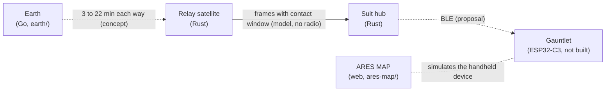
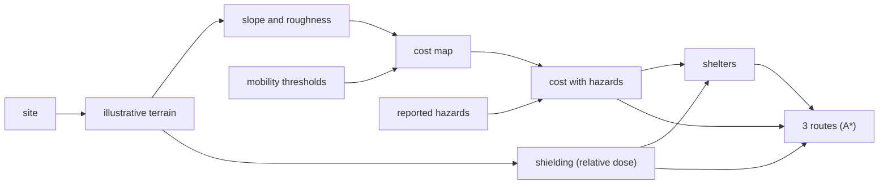
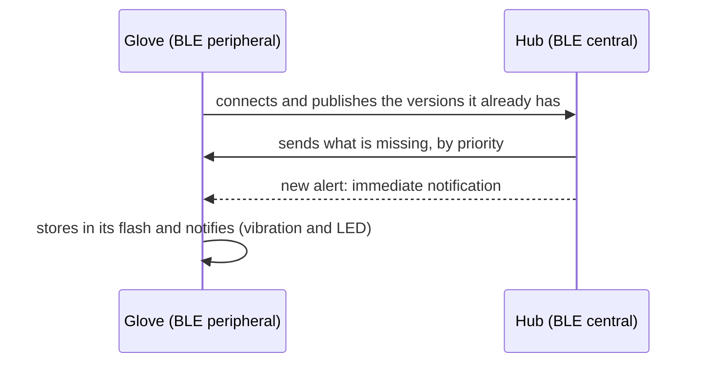

# How it all works

A guide to the whole project: what it does, how it is built and how it would connect to the gauntlet (the glove).
Every claim is labelled **real** (it exists and was tested), **simulated** (it exists on screen but is not the real thing)
or **proposal** (a design that is pending and not built).

Spanish original: [COMO_FUNCIONA.md](COMO_FUNCIONA.md).

## 1. In 30 seconds

The project has two parts that tell the same idea:

1. **ARES MAP** (`ares-map/`): a web app that is the **usable map**. It is what gets demonstrated. It runs in the browser,
   needs no server, and keeps working without a network.
2. **Glove link prototype** (`crates/`, `earth/`): Rust and Go code that defines how data would travel from Earth to the
   glove (frames, priorities, queues). It is **not connected to the web app** and there is no hardware.

> **About BLE:** the gauntlet has *no BLE yet*. The ESP32-C3 board was chosen because it has a BLE 5 radio, but there is no
> Bluetooth code and no firmware written. The "Glove" tab of the app is a **simulation** in the browser.
> See section 6.

## 2. What is real and what is not

| Piece | Status | Detail |
|---|---|---|
| Mars imagery (Viking, MOLA, HRSC, THEMIS) | **Real** | Public NASA Trek and USGS servers |
| Curiosity and Perseverance traverse and waypoints | **Real** | NASA MMGIS, Curiosity up to sol 5073 and Perseverance up to sol 2022 |
| Earth-Mars distance and latency | **Real** | Offline ephemeris, validated against JPL Horizons on **2 dates** (15 and 16 Nov 2026), with a difference below 0.1 %. The 3 and 22 min extremes were not validated |
| Radiation baseline at Gale (0.67 mSv/day) | **Real** | Measurement by the RAD instrument, not real time |
| AOI relief (10 km), slopes, cost, shielding, shelters | **Illustrative** | Terrain generated by the team, anchored to the measured elevation of one real waypoint; the app warns about it on screen |
| Surface weather (temperature and pressure) | **Illustrative** | **Invented** series that imitates a daily cycle; the real data would come from REMS (Curiosity) or MEDA (Perseverance) |
| Space-weather alerts | **Illustrative** | NASA DONKI schema with invented values |
| Protocol card, health event simulator | **Concept** | Not an official procedure |
| Glove tab | **Simulated** | Simulated position, there is no glove |
| Rust/Go link | **Prototype** | Tested with unit tests, not with a radio |

## 3. What ARES MAP does

It is organised in nine tabs. Every datum carries a badge with **source, date, tier and confidence**; anything estimated
is marked "ESTIMATED" (estimated).

| Tab | What it allows |
|---|---|
| **Map** | Choose a site (Gale or Jezero), switch base and thermal layers on with opacity control, and prepare offline mode |
| **Points** | See the real rover traverse and the points of interest (12 real waypoints per site, an inferred boxwork zone only at Gale, and up to 6 computed shelters). Each has a card and can be used as start A or destination B |
| **Terrain** | Layers for slope, roughness, contour lines, cost map and shading. Editable mobility thresholds that recompute everything live. Click to probe a point |
| **Weather** | Temperature and pressure for one sol (7 sols available, with a slider), with the night band and the maxima and minima. **The series is invented**, is marked "ESTIMATED" and uses the same scale on every sol so they can be compared. From here the real THEMIS day and night thermal layers are switched on |
| **Route** | Set A and B, or load an example. Compares three routes (shortest, safest, with a nearby shelter) by distance, time, slope, risk and elevation profile. **Report hazard** marks a blocked zone and the routes are recomputed |
| **Safety** | Shielding layer, shelter zones, three sample solar alerts and the protocol card with countdown, nearest shelter and time margin |
| **Crew** | Mission sol slider, clock offset, estimated accumulated radiation, five step-by-step event simulators and health risks with sources (several marked "pending source") |
| **Link** | Earth-to-Mars latency for a date, a 2025-2030 chart and a "no response" warning |
| **Glove** | Concept view: alert code, heading arrow, distance and link status, with a simulated position error |

Other product rules:

- **Data from two sites is never mixed.** Incidents, POIs and absolute dose belong to one site.
- **Offline first.** The app is a PWA; it stores the imagery of the initial view and all computation runs in the browser.
- **On a phone** the panel can be hidden, and it hides itself while a point is being picked on the map.

## 4. Architecture

### 4.1 The complete system



- **Solid line (satellite to hub):** the model exists in Rust and has tests (frames, queue, windows and byte budget), but **no radio and no transport**; the physical medium is not defined.
- **Dotted line:** proposal or simulation. Earth to satellite is concept only: the Go side defines constants and types, with no messages and no transport.
- The data core would live on the **satellite**, so that no decision has to wait for Earth.

### 4.2 Status of each node

| Node | Language | What exists today |
|---|---|---|
| Earth | Go | `earth/layers`: mirror of the data model (layers, priorities, tile header). 36 lines. No real ingestion: the executable only prints constants |
| Shared core | Rust `no_std` | `crates/core`: messages, CRC frame, priority queue. 19 tests |
| Link (std nodes) | Rust | `crates/link`: `Outbox` and `Transmitter`. 10 tests |
| Hub | Rust | `crates/hub`: receives frames, drops duplicates and stale ones, forwards to the glove. 7 tests |
| Satellite | Rust | `crates/satellite`: only a demo that enqueues messages and prints the size of each frame in departure order |
| Glove | Rust (planned) | `firmware/glove/`: only a note; there is no code |

### 4.3 How ARES MAP is built

The pure logic (no UI) is separated from the interface, and everything is tested without a browser.

```
src/terrain   relief generation, slope/aspect/roughness, shielding, probing, layer drawing
src/routing   cost map, A*, route planner, incidents
src/safety    shelters, protocol evaluation
src/crew      health content, per-sol calculations, event guides
src/data      real traverses, points of interest, sample alerts
src/lib       provenance metadata, ephemeris, geometry, simulated weather, offline mode
src/map       OpenLayers: layers, traverse, routes, markers
src/ui        panels for each tab
src/App.tsx   wires everything together (state and chained computation)
```

The computation is a chain that is recomputed only when its input changes:



- The terrain layers are drawn as PNG images over the map; the cost map is redrawn when thresholds are edited.
- Reported hazards are stored in the browser (`localStorage`) and applied only to the site where they were marked.
- **There is no server.** The maps come from NASA/USGS and are stored in the `ares-tiles` cache; the service worker serves
  the app and those images without a network.
- Two image servers with a limit found by probing: Trek tiles only reach level 7 (about 325 m/pixel).

## 5. The data link (Rust)

This is the design of **how** information would travel. What exists is tested with unit tests.

### 5.1 Messages and priorities

| Message | Content | Priority | Frame size |
|---|---|---|---|
| `Event` | Solar alert (arrival, severity, dose multiplier) | **Alert** (leaves first) | **32 B** with real timestamps (21 B with the demo's toy values) |
| `Poi` | Add, change or removal of a point of interest (versioned) | Route | under 24 B |
| `Contact` | Next communication window of the relay | Route | **17 B** real (10 B with toy values) |
| `Tile` | Header plus 4,096 bytes of a map layer | Base (leaves last) | about 4.1 KB |

### 5.2 How a message travels

1. It is serialised with **postcard** (compact binary, suitable for microcontrollers).
2. A **CRC-32** is appended to detect corruption.
3. It is wrapped with **COBS**, which ends every frame with a `0x00` so the receiver can resynchronise if bytes are lost.

One test flips one bit at every position of an alert frame (except the final delimiter) and checks that no variant is accepted. Another test pins the real sizes: 32 B for the alert and 17 B for the contact.

### 5.3 Queue and transmission

- **`PriorityQueue`:** fixed capacity, no dynamic memory. The most urgent leaves first and, within a class, the oldest. If it is full, a more urgent message evicts the oldest one of the **least urgent class present**: normally a tile, but it can be a POI or a contact if no tiles are left. If everything queued is equally or more urgent, the new message is **rejected** (a new alert does not displace other alerts).
- **`Transmitter`:** only lets frames out inside the **contact window**, with a byte budget per window (`bytes per second x duration`). If the most urgent frame does not fit in what remains, no less urgent frame overtakes it. Exception: a frame larger than the **entire** window is **dropped for good** (of any priority, alerts included) and counted separately; it is not kept for a longer window.

### 5.4 What the hub does on receipt

- Tiles and POIs: the **highest version** wins; equal is a duplicate; lower is stale. A deleted POI is kept as a marker so that a late "add" cannot revive it.
- Contact windows: they have no version; the new one replaces the previous one, and an identical one counts as a duplicate.
- Alerts: they have no version, so they are ordered by issue time; a new alert may declare that it replaces another.
- **Only alerts, POIs and windows are forwarded to the glove.** Tiles stay at the hub.
- **Known limits:** an old contact window arriving late overwrites a newer one (it has no version), and a re-sent alert with the same issue time but a different state or severity is dropped as a duplicate.

## 6. Syncing with the gauntlet (BLE)

### 6.1 What exists today

- **Hub:** has an outbound queue to the glove (`hub.glove`) with the frames ready. **Nothing transmits them.**
- **Shared core:** `nasamars-core` is `no_std` precisely so that it can also compile inside the glove, but it **has not been compiled for the microcontroller yet** (the `riscv32imc` target still has to be installed and tried).
- **Firmware:** a note. It says it would use `esp-hal` and Embassy and would show a local map, an arrow to the shelter, the radiation level and an alert with vibration and LED.
- **Glove tab of the web app:** draws how the screen would look. The position is simulated; it does not talk to any device.

### 6.2 Why ESP32-C3

Design decision: a classic AVR board (2 KB of RAM) is not enough for a 4 KB tile, and an RP2040 has no radio. The
ESP32-C3 has a BLE 5 radio and is cheap. **It has not been tested on hardware.**

### 6.3 Proposal for how it would sync (not built)



- **Roles:** the hub is the central; the glove is the peripheral that advertises itself.
- **Alerts:** sent as a notification as soon as they arrive; the glove vibrates and lights the LED.
- **Reconnection:** on reconnecting, the glove reports which versions it has and the hub sends only the difference.
- **No database in the glove:** it keeps the minimum in memory and asks again for the rest.
- **Pairing:** done once, before departure. Afterwards the glove and the hub recognise each other automatically.

**Own service (GATT)**, with two channels:

| Channel | Direction | Purpose |
|---|---|---|
| Notifications | hub to glove | Deliver the already defined frames (alerts, POIs, contact windows) as soon as they are ready |
| Write | glove to hub | Report which versions it already has and confirm that it received each frame |

The glove answers with a receipt acknowledgement; if the hub does not receive it, it re-sends the frame.

### 6.4 Concrete problems to solve

1. **Packet size.** With the default BLE size (23 bytes, 20 useful per notification), a real **32-byte** alert (with UTC timestamps in seconds; 21 with the toy values) **does not fit**. A larger MTU has to be negotiated, or the frame fragmented. A tile of about 4.1 KB will always need fragmentation.
2. **Send tiles to the glove?** Today the hub does not. Proposal: send only a crop around the position, or directly the route vector and the shelters, because the screen is small.
3. **COBS over BLE.** BLE already delimits each message, so COBS may be redundant; the CRC is probably kept. Open decision.
4. **Position without GPS.** There is no Martian GPS. Today the position is the position of point A plus a configurable error; a real glove needs an inertial or map-matching method, not yet designed.
5. **Radio power consumption and range**, not measured.

### 6.5 BLE stack in Rust: TrouBLE (verified on the web)

[TrouBLE](https://github.com/embassy-rs/trouble) is a BLE host in Rust for embedded systems. What was confirmed by reading its repository:

| Point | What the repository says |
|---|---|
| Supports the ESP32-C3 | **Yes.** The `examples/esp32` example lists `esp32c3` among its chips, and its `Cargo.toml` uses `esp32c3` as the default feature |
| Builds for our target | Its integration script (`ci.sh`) builds the example with `--features esp32c3 --target riscv32imc-unknown-none-elf`, the same target our `firmware/glove/README.md` notes |
| GATT server | "Basic GATT server supporting write, read, notifications", exactly what the service in section 6.3 needs |
| Connection-oriented L2CAP channels | Supported, with credit-based flow control, in both central and peripheral. They are useful for sending long frames (such as a tile) without fragmenting by hand |
| Roles | Peripheral (advertise and accept connections) and central (scan and connect) |
| License | MIT or Apache-2.0 |

What was **not** confirmed:

- **That it works on a real board.** That the example builds in its integration does not prove that it connects to a hub.
- **That it is stable.** The example uses `esp-hal` 1.1.0 with the `unstable` feature, `esp-radio` 1.0.0-beta.0 and dependencies pinned to a git commit. That is, it relies on beta versions.
- **The GitHub workflow files.** Only their names were seen (publishing ones), so I do not know whether that build runs automatically on every change.
- **Whether it builds today with our code.** Nobody has tried it yet with `nasamars-core`.

### 6.6 Next steps toward a real glove

1. Compile `nasamars-core` for the `riscv32imc` target and check that it fits in the board's RAM and flash.
2. Start from TrouBLE's `examples/esp32` example for the ESP32-C3 and check that it advertises, connects and notifies on a real board.
3. Make the hub transmit its `hub.glove` queue over BLE.
4. Measure the real MTU size and the throughput.
5. (Optional) Connect the web app to a real glove with **Web Bluetooth**, available in Chrome and Edge (desktop and Android) and not in Safari or Firefox. It would have to be checked whether the browser used for the demo has it enabled.

## Where every real datum comes from

Everything listed here is **real**. The browser fetches it directly from the public server; there is no backend of ours in between. Everything not listed here is illustrative or concept (see the next table).

| Datum | Server and address | How it reaches the app | Scope | Limits |
|---|---|---|---|---|
| Viking MDIM 2.1 color mosaic (base image) | NASA Trek WMTS, `https://trek.nasa.gov/tiles/Mars/EQ/` (layer `Mars_Viking_MDIM21_ClrMosaic_global_232m`) | Image tiles requested by the map (OpenLayers); stored in the `ares-tiles` cache for offline use | Global | Tiles exist only up to level 7 (about 325 m/px, not the 232 m of the layer name); blurry at walking scale |
| MOLA color, HRSC+MOLA hillshade, THEMIS day, THEMIS night | USGS Astrogeology WMS, `https://planetarymaps.usgs.gov/cgi-bin/mapserv?map=/maps/mars/mars_simp_cyl.map` (layers `MOLA_color`, `HRSC_MOLA_Blend_Hillshade`, `THEMIS`, `THEMIS_night`) | WMS GetMap images requested by the map; stored in the `ares-tiles` cache | Global | Imagery only: no elevation values are read from these layers. The layer names in the original spec (`THEMIS_IR_Day`, `THEMIS_IR_Night`) do not exist |
| Curiosity and Perseverance waypoints and traverse | NASA MMGIS, `https://mars.nasa.gov/mmgis-maps/MSL/Layers/json/MSL_waypoints.json` and `.../M20/Layers/json/M20_waypoints.json` | Downloaded once by `scripts/build_rover_data.mjs` and compacted into `src/data/gale.rover.json` and `src/data/jezero.rover.json`; shipped inside the app | Curiosity: 1389 waypoints, sol 3 to 5073. Perseverance: 708 waypoints, sol 13 to 2022 | Snapshot retrieved on 2026-11-15; it is not updated at run time. Perseverance's real positions are about 20 km west of the landing coordinates in the spec, so the Jezero AOI follows the measured data |
| Earth-Mars distance and light-time latency | Computed offline in the browser with `astronomy-engine` (`src/lib/ephemeris.ts`); no server | No network request | Any date | Validated against JPL Horizons (`https://ssd.jpl.nasa.gov/horizons/`) on 2 dates (2026-11-15: 1.31585 AU; 2026-11-16: 1.30733 AU), within 0.1 %. The 3 and 22 minute extremes were not validated |
| Radiation baseline at Gale: 0.67 mSv/day | MSL/RAD, Hassler et al., *Science* 343 (2014); stored as a constant (`RAD_GALE_MSV_PER_DAY` in `src/terrain/shielding.ts`) | Compiled into the app | Gale only; mean of Aug 2012 to Jun 2013 | A literature value, not real time. Applied to Gale only, never shown for Jezero |

### What is not real

| Item | Why |
|---|---|
| Terrain relief of the 10 km AOI (slope, roughness, cost, shielding, shelters) | Synthetic; only its elevation at one point per site is anchored to a real waypoint elevation |
| Surface weather (temperature, pressure) | Invented series that imitates a daily cycle; REMS and MEDA were not probed and no data is shipped |
| Space-weather alert values | Invented; only the format follows NASA DONKI. A real snapshot could not be taken (the `DEMO_KEY` rate limit was exhausted) |
| Mobility thresholds | Team assumptions, not calibrated against Jezero |
| Glove and BLE | The glove tab is a simulation; no BLE code or firmware exists |

## 7. How to run and test it

```
# Web app
cd ares-map
npm install
npm run dev                         # development
npm test                            # 61 tests
npm run build && npm run preview    # build with service worker (offline mode)

# Rust
cargo test --workspace              # 36 tests
```

Three-minute demo script and checklist: `ares-map/docs/DEMO.md`.

### What was tested in a real browser

Map and layers, example route, alert with protocol card, hazard report with recomputation, switch to Jezero, click on
waypoints, weather panel (sol slider, THEMIS shortcut), offline mode (reload without network), phone view and collapsible panel. One real bug was found and fixed
along the way.

**Not tested:** touch gestures on a physical phone, other browsers, and any hardware.

## 8. Limits worth saying out loud

- The AOI relief is synthetic (only its height at one point matches the measured elevation of a real waypoint); the rover traverse is real and is drawn on top of it.
- The grid models do not match across the parts: Rust and Go use 64x64 tiles with 100 m cells, the web app uses 20 m cells (512x512) and the spec speaks of 10 m. A link "tile" is not equivalent to a unit of the app's terrain.
- **Surface weather is an invented series** (the temperature and pressure panel requested by the spec, F3). It imitates the shape of a daily cycle, but they are not REMS or MEDA measurements, and wind is not simulated. Connecting real data would first require probing where to download it from.
- Mobility thresholds are team assumptions, not calibrated against Jezero.
- Solar alerts are a sample with the DONKI schema, not a forecast.
- Several health items are marked "pending primary source".
- The gauntlet, positioning without GPS and medical AI are **concepts**.

## 9. Sources for section 6

- [TrouBLE: README and examples (embassy-rs)](https://github.com/embassy-rs/trouble)
- [TrouBLE: ESP32 example](https://github.com/embassy-rs/trouble/tree/main/examples/esp32)
- [TrouBLE: integration script `ci.sh`](https://github.com/embassy-rs/trouble/blob/main/ci.sh)
- [BLE: ATT MTU, length extension and message size (Punch Through)](https://punchthrough.com/ble-att-mtu-throughput/)
- [A Riscy Move: ESP32-C3 as a SoC with Bluetooth 5 (LE) (Hackaday)](https://hackaday.io/project/205774-a-riscy-move/log/249783-finally-getting-risc-v-blinky-working)

Note: the fact that the ESP32-C3 has Bluetooth 5 (LE) comes from a secondary source; which specific BLE 5 features it supports (for example the 2 Mbps PHY) was not confirmed against the manufacturer's datasheet.
